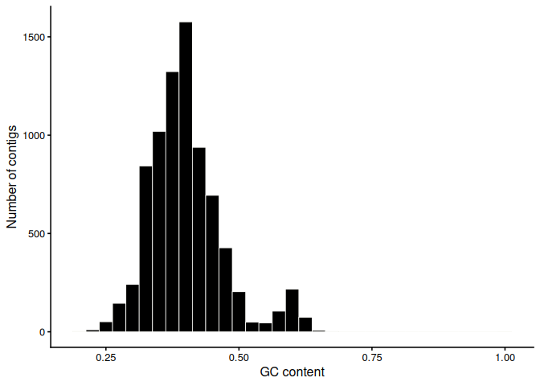
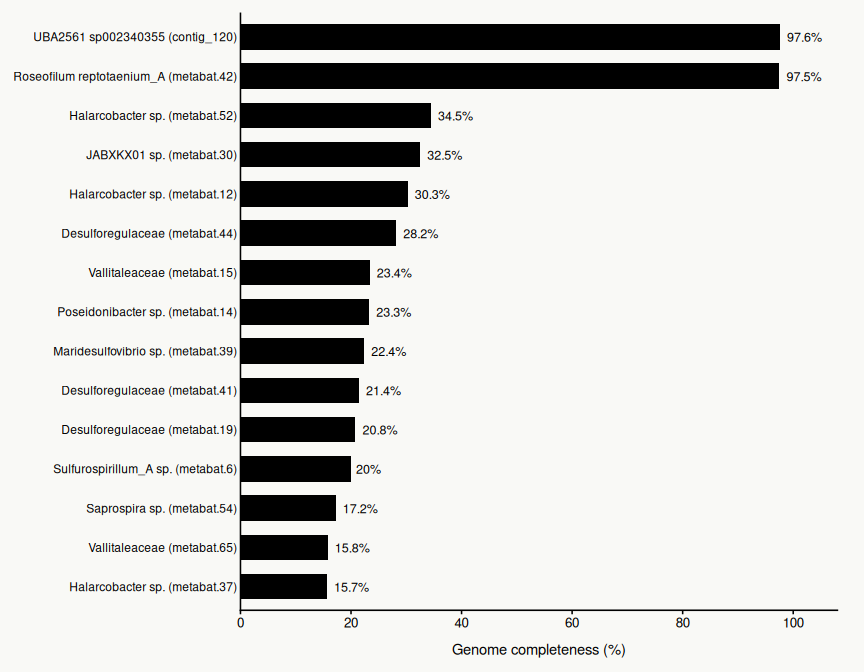

07_Data_Visualization
================
Kendra
2026-11-19

### Assembly summary

Summary statistics were calculated from the final black band disease
(BBD) metagenome assembly generated with Flye. These metrics describe
the overall size and contiguity of the assembly:

``` r
assembly <- readDNAStringSet("flye/bbd/assembly.fasta")

contig_lengths <- width(assembly)
sorted_lengths <- sort(contig_lengths, decreasing = TRUE)

cumulative_length <- cumsum(sorted_lengths)

n50 <- sorted_lengths[
  which(cumulative_length >= sum(sorted_lengths) / 2)[1]
]

assembly_table <- tibble(
  Metric = c(
    "Total assembly length",
    "Number of contigs",
    "N50",
    "Longest contig",
    "Mean contig length",
    "Median contig length"
  ),
  Value = c(
    paste0(round(sum(contig_lengths) / 1e6, 2), " Mb"),
    format(length(contig_lengths), big.mark = ","),
    paste0(format(n50, big.mark = ","), " bp"),
    paste0(format(max(contig_lengths), big.mark = ","), " bp"),
    paste0(format(round(mean(contig_lengths)), big.mark = ","), " bp"),
    paste0(format(round(median(contig_lengths)), big.mark = ","), " bp")
  )
)

kable(
  assembly_table,
  caption = "Table 1. Summary statistics for the BBD metagenome assembly generated with Flye.",
  align = c("l", "r")
)
```

| Metric                |        Value |
|:----------------------|-------------:|
| Total assembly length |      66.6 Mb |
| Number of contigs     |        7,974 |
| N50                   |    13,007 bp |
| Longest contig        | 4,706,701 bp |
| Mean contig length    |     8,352 bp |
| Median contig length  |     3,985 bp |

Table 1. Summary statistics for the BBD metagenome assembly generated
with Flye.

### GC content

GC content was calculated for each assembled contig to describe
variation in nucleotide composition across the metagenome:

``` r
gc_content <- letterFrequency(
  assembly,
  letters = c("G", "C")
)

gc_df <- tibble(
  GC = rowSums(gc_content) / width(assembly)
)

figure1 <- ggplot(gc_df, aes(x = GC)) +
  geom_histogram(
    binwidth = 0.025,
    fill = "black",
    colour = "#f9f9f6",
    linewidth = 0.3
  ) +
  labs(
    x = "GC content",
    y = "Number of contigs"
  ) +
  theme_classic(base_size = 12) +
  theme(
    panel.background = element_rect(fill = "transparent", colour = NA),
    plot.background = element_rect(fill = "transparent", colour = NA),
    axis.text = element_text(colour = "black"),
    axis.title = element_text(colour = "black")
  )

print(figure1)
```

<!-- -->
Figure 1. Distribution of GC content among contigs in the BBD metagenome
assembly.

### Genome quality and taxonomic classification

Genome-bin completeness and contamination were obtained from CheckM,
while taxonomic classifications were obtained from GTDB-Tk. These
results were combined to identify the major genome components recovered
from the BBD metagenome:

``` r
gtdbtk <- read_tsv(
  "gtdbtk/gtdbtk.bac120.summary.tsv",
  show_col_types = FALSE
)

gtdbtk_taxonomy <- gtdbtk |>
  separate_wider_delim(
    classification,
    delim = ";",
    names = c(
      "domain",
      "phylum",
      "class",
      "order",
      "family",
      "genus",
      "species"
    )
  ) |>
  mutate(
    across(
      c(domain, phylum, class, order, family, genus, species),
      ~ str_remove(.x, "^[a-z]__")
    )
  ) |>
  select(
    user_genome,
    domain,
    phylum,
    class,
    order,
    family,
    genus,
    species
  )
```

``` r
checkm_lines <- readLines(
  "checkm/checkm_results_bbd.txt"
)

checkm_lines <- checkm_lines[
  grepl(
    "^(contig_|metabat\\.)",
    trimws(checkm_lines)
  )
]

checkm_split <- strsplit(
  trimws(checkm_lines),
  "\\s+"
)

checkm_df <- do.call(
  rbind,
  lapply(checkm_split, function(x) {
    data.frame(
      bin = x[1],
      lineage = x[2],
      completeness = as.numeric(x[13]),
      contamination = as.numeric(x[14])
    )
  })
)
```

``` r
genome_summary <- checkm_df |>
  left_join(
    gtdbtk_taxonomy,
    by = c("bin" = "user_genome")
  ) |>
  mutate(
    taxon = case_when(
      !is.na(species) & species != "" ~ species,
      !is.na(genus) & genus != "" ~ paste0(genus, " sp."),
      !is.na(family) & family != "" ~ family,
      !is.na(order) & order != "" ~ order,
      !is.na(class) & class != "" ~ class,
      !is.na(phylum) & phylum != "" ~ phylum,
      TRUE ~ "Unclassified"
    ),
    taxon_label = paste0(taxon, " (", bin, ")")
  )
```

#### Genome completeness

Only genome bins with greater than 15% estimated completeness, which
were retained for downstream taxonomic and functional analysis, are
shown.

``` r
genome_top <- genome_summary |>
  filter(completeness > 15) |>
  arrange(completeness)

figure2 <- ggplot(
  genome_top,
  aes(
    x = completeness,
    y = reorder(taxon_label, completeness)
  )
) +
  geom_col(
    fill = "black",
    width = 0.65
  ) +
  geom_text(
    aes(label = paste0(round(completeness, 1), "%")),
    hjust = -0.2,
    size = 3.3,
    colour = "black"
  ) +
  scale_x_continuous(
    limits = c(0, 108),
    breaks = seq(0, 100, 20),
    expand = expansion(mult = c(0, 0))
  ) +
  labs(
    x = "Genome completeness (%)",
    y = NULL
  ) +
  theme_classic(base_size = 12) +
  theme(
    # Match ePortfolio background
    plot.background = element_rect(
      fill = "#f9f9f6",
      colour = NA
    ),
    panel.background = element_rect(
      fill = "#f9f9f6",
      colour = NA
    ),

    # Clean typography
    axis.text.x = element_text(
      colour = "black",
      size = 10
    ),
    axis.text.y = element_text(
      colour = "black",
      size = 9
    ),
    axis.title.x = element_text(
      colour = "black",
      size = 11,
      margin = margin(t = 10)
    ),

    # Clean spacing
    axis.ticks.y = element_blank(),
    plot.margin = margin(10, 20, 10, 10)
  )

print(figure2)
```

<!-- -->
Figure 2. Estimated completeness of genome bins of the BBD metagenome.
Taxonomic labels represent the lowest classification assigned by
GTDB-Tk. Only bins with \>15% estimated completeness are shown.

### Major genome components

``` r
taxonomy_table <- genome_top |>
  arrange(desc(completeness)) |>
  transmute(
    Bin = bin,
    Taxon = taxon,
    Phylum = phylum,
    `Completeness (%)` = round(completeness, 2),
    `Contamination (%)` = round(contamination, 2)
  )

kable(
  taxonomy_table,
  caption = "Table 2. Quality and taxonomic classification of genome bins",
  align = c("l", "l", "l", "r", "r")
)
```

| Bin | Taxon | Phylum | Completeness (%) | Contamination (%) |
|:---|:---|:---|---:|---:|
| contig_120 | UBA2561 sp002340355 | Bacteroidota | 97.62 | 1.64 |
| metabat.42 | Roseofilum reptotaenium_A | Cyanobacteria | 97.50 | 0.67 |
| metabat.52 | Halarcobacter sp. | Campylobacterota | 34.48 | 0.00 |
| metabat.30 | JABXKX01 sp. | Firmicutes_A | 32.51 | 1.77 |
| metabat.12 | Halarcobacter sp. | Campylobacterota | 30.28 | 0.00 |
| metabat.44 | Desulforegulaceae | Desulfobacterota | 28.18 | 0.13 |
| metabat.15 | Vallitaleaceae | Firmicutes_A | 23.38 | 0.00 |
| metabat.14 | Poseidonibacter sp. | Campylobacterota | 23.28 | 0.00 |
| metabat.39 | Maridesulfovibrio sp. | Desulfobacterota_I | 22.41 | 0.00 |
| metabat.41 | Desulforegulaceae | Desulfobacterota | 21.43 | 0.00 |
| metabat.19 | Desulforegulaceae | Desulfobacterota | 20.79 | 0.00 |
| metabat.6 | Sulfurospirillum_A sp. | Campylobacterota | 19.98 | 0.00 |
| metabat.54 | Saprospira sp. | Bacteroidota | 17.24 | 0.00 |
| metabat.65 | Vallitaleaceae | Firmicutes_A | 15.79 | 0.00 |
| metabat.37 | Halarcobacter sp. | Campylobacterota | 15.67 | 0.00 |

Table 2. Quality and taxonomic classification of genome bins

## Gene annotation

``` r
bins <- readLines(
  "checkm/bbd_topbins.txt"
)

prokka_all <- map_dfr(
  bins,
  function(bin) {
    read_tsv(
      paste0(
        "prokka/",
        bin,
        "/",
        bin,
        ".tsv"
      ),
      show_col_types = FALSE
    ) |>
      mutate(bin = bin)
  }
)

total_features <- nrow(prokka_all)

genes_with_ec <- prokka_all |>
  filter(
    !is.na(EC_number),
    EC_number != ""
  ) |>
  nrow()

ec_percent <- (
  genes_with_ec /
  total_features
) * 100

prokka_summary <- tibble(
  Metric = c(
    "Features annotated by Prokka",
    "Features assigned an EC number",
    "Features with an EC assignment"
  ),
  Value = c(
    format(total_features, big.mark = ","),
    format(genes_with_ec, big.mark = ","),
    paste0(round(ec_percent, 1), "%")
  )
)

kable(
  prokka_summary,
  align = c("l", "r")
)
```

| Metric                         |  Value |
|:-------------------------------|-------:|
| Features annotated by Prokka   | 20,474 |
| Features assigned an EC number |  5,244 |
| Features with an EC assignment |  25.6% |

## Metabolic pathway analysis

``` r
pathway_table <- tribble(
  ~Bin, ~Taxon, ~Pathway, ~`Families detected`, ~MinPath,
  "contig_120", "UBA2561 sp002340355", "PWY-101", "1/4", 0,
  "metabat.15", "Vallitaleaceae", "PWY-101", "1/4", 1,
  "metabat.41", "Desulforegulaceae", "PWY-101", "1/4", 0,
  "metabat.42", "Roseofilum reptotaenium_A", "PWY-101", "4/4", 1,
  "metabat.12", "Halarcobacter sp.", "PWY-5360", "1/3", 0
)

kable(
  pathway_table,
  caption = "Table 3. Detection of selected metabolic pathways within genome bins from the BBD metagenome.",
  align = c("l", "l", "l", "c", "c")
)
```

| Bin        | Taxon                     | Pathway  | Families detected | MinPath |
|:-----------|:--------------------------|:---------|:-----------------:|:-------:|
| contig_120 | UBA2561 sp002340355       | PWY-101  |        1/4        |    0    |
| metabat.15 | Vallitaleaceae            | PWY-101  |        1/4        |    1    |
| metabat.41 | Desulforegulaceae         | PWY-101  |        1/4        |    0    |
| metabat.42 | Roseofilum reptotaenium_A | PWY-101  |        4/4        |    1    |
| metabat.12 | Halarcobacter sp.         | PWY-5360 |        1/3        |    0    |

Table 3. Detection of selected metabolic pathways within genome bins
from the BBD metagenome.
